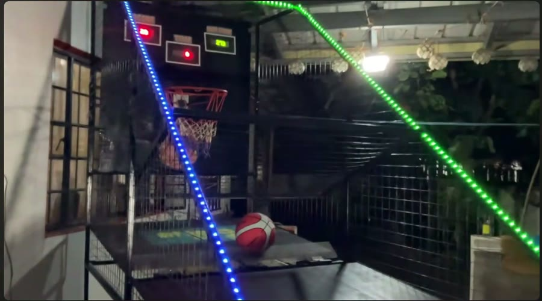

# Arcade Basketball (ESP32)

Coin-operated arcade basketball machine on an ESP32. Coins add credits, the start button
starts a 2-round game, an ultrasonic sensor counts shots, a servo gate releases the balls, and
three LED matrix boards show Time, Score and High Score.

Firmware: [`src/main.cpp`](src/main.cpp). PlatformIO config: [`platformio.ini`](platformio.ini).

## Demo video

[](docs/demo.mp4)

[`docs/demo.mp4`](docs/demo.mp4) (33 s) shows the finished cabinet: the ball ramp and gate,
the hoop, and the three scoreboard displays (Time, Score, High Score) on the backboard.
Click the image, then **View raw** to download or play it.

## Build and upload

Needs [PlatformIO](https://platformio.org/) (VS Code extension or `pip install platformio`).

```bash
pio run                  # compile
pio run -t upload        # flash the ESP32
pio device monitor       # serial monitor at 115200
```

If upload fails with **Wrong boot mode detected**: hold **BOOT**, tap **EN**, then release
**BOOT** once the upload starts.

Libraries are pulled automatically: MD_Parola, MD_MAX72XX, ESP32Servo, plus the built-in Preferences.

## 1. Hardware

| Component | Role |
|---|---|
| ESP32 DevKit (30-pin, PlatformIO board `esp32dev`) | Controls everything |
| Allan coin slot (1/5/10/20 PHP) | Sends 1, 5, 10 or 20 pulses per coin |
| 3x MAX7219 32x8 (FC16, 4 chips each) | Time, Score and High Score displays |
| A02YYUW UART ultrasonic, Auto variant | Shot detection, 9600 baud, 3 to 450 cm, about 3 cm blind zone |
| MG996R servo | Ball gate |
| Illuminated 4-wire arcade button | Start button |
| Active piezo buzzer | Beeps |
| 12 V SMPS + LM2596 buck (5 V) | Power |

## 2. Pins

| Function | GPIO |
|---|---|
| Coin slot | 4 (INPUT_PULLUP, falling-edge interrupt) |
| Start button | 22 (INPUT_PULLUP, pressed = LOW) |
| Buzzer | 32 |
| Servo signal | 13 |
| Ultrasonic TX2 / RX2 | 25 / 35 |
| MAX7219 DIN / CLK (shared by all 3 boards) | 23 / 18 |
| MAX7219 CS: Time / Score / High Score | 27 / 19 / 21 |

## 3. Wiring rules

- All grounds are common: SMPS, buck, ESP32, Allan COM, servo, sensor and displays.
- Buck 5 V goes to ESP32 VIN. The Allan is powered from the 12 V SMPS.
- Coin line: 10 kOhm pull-up to 3.3 V plus 100 nF to GND on GPIO4.
- Sensor: VCC to 5 V. Sensor TX goes to GPIO35, sensor RX goes to GPIO25. GPIO35 is input-only, so it must be the RX line.
- Servo power comes from the 5 V buck output, with a capacitor.

## 4. Game logic

```
IDLE_CREDITS -> PRE_ROUND_LABEL -> PRE_READY -> PRE_COUNTDOWN -> PRE_START -> PLAYING
PLAYING -> ROUND_GAP_WAIT (into Round 2) -> PRE_ROUND_LABEL ...
PLAYING -> GAME_OVER_WAIT -> IDLE_CREDITS
```

- 20 PHP per game, deducted when the button is pressed. Coins are accepted in every state.
- Round 1 is 60 s at +2 per shot. A score of 50 or more is needed to continue.
- Round 2 is 30 s at +3 per shot, after a 3 s pause. It is the last round.
- Score carries over between rounds. High score and coin balance are saved in flash.
- The gate is up when idle and down during rounds. It goes back up after each round.
- Buzzer: a beep on every pre-round phase change, and during the last 3 seconds.
- A shot counts when the reading is 5 to 35 cm, with a 400 ms cooldown. Scoring only runs in the PLAYING state.

What the displays show:

| State | Time | Score | High Score |
|---|---|---|---|
| IDLE_CREDITS | Balance, e.g. `P15` | Scrolls `INSERT P20` or `PRESS START` | High score |
| PRE_ROUND_LABEL | Scrolls `ROUND 1` / `ROUND 2` | Score | High score |
| PRE_READY / PRE_COUNTDOWN / PRE_START | `READY`, `3`, `2`, `1`, `GO!` | Score | High score |
| PLAYING | Seconds left | Score | High score (live if beaten) |
| ROUND_GAP_WAIT | `PASS` | Score | High score |
| GAME_OVER_WAIT | Scrolls `GAME OVER` or `NEW HIGH SCORE` | Final score | High score |

## 5. Key constants

All at the top of `src/main.cpp`:

`PESO_PER_GAME=20`, `PULSE_DIVISOR=2`, `PULSE_GAP_MS=180`, `DEBOUNCE_MS=30`, `SHOT_MIN_CM=5`,
`SHOT_MAX_CM=35`, `SHOT_COOLDOWN_MS=400`, `SERVO_REST_ANGLE=98`, `SERVO_OPEN_ANGLE=0`,
`DISPLAY_REFRESH_MS=5000`, `DEEP_REINIT_MS=30000`.

Extra: `SHOT_REARM_ON_CLEAR` (default `false`). Set it to `true` to also require one
out-of-range reading between shots, so a ball resting in front of the sensor can't keep scoring.

## 6. Code structure

- Each `loop()` pass animates the 3 displays, then runs `handleCoins`, `handleBuzzer`,
  `handleDisplayWatchdog`, `handleUltrasonicUART`, `debugPrintUltrasonic`, and then the state switch.
- Nothing blocks. All timing uses `millis()`, with no `delay()` in the game.
- `coinISR` is marked `IRAM_ATTR`. It debounces and counts pulses, and `handleCoins` groups them into one coin value.
- `handleUltrasonicUART` is a non-blocking parser for `[0xFF][high][low][checksum]` frames.
  The checksum is `(0xFF + high + low) & 0xFF`, and the distance in mm divided by 10 gives cm.

## 7. Lessons learned

- Coin pulses doubled after adding the capacitor, so `PULSE_DIVISOR=2` fixes it in software.
- `PULSE_GAP_MS` is 180. The measured gap inside one coin is 120 ms. 100 split coins apart and 300 merged separate coins.
- HC-SR04 was replaced. It was unstable, its blind zone overlaps the shot distance, and it is unreliable over a long cable.
- Scroll text needs static buffers. A stack buffer caused garbage characters on ROUND 1 and ROUND 2.
- PlatformIO needs explicit function prototypes. It compiles `main.cpp` as plain C++ and does not auto-generate them like the Arduino IDE does for `.ino` files.
- Display glitches: a full `begin()` every 2 s made the garbage worse. Now a light redraw runs every 5 s and a full re-init every 30 s.
- Upload error *Wrong boot mode detected*: hold BOOT, tap EN, then release BOOT once the upload starts.

## 8. Troubleshooting the sensor

The serial monitor (115200) prints this every 500 ms:

```
[US-DEBUG] bytesSeen=... validFrames=... checksumFails=... latestDistanceCm=...
```

- `bytesSeen = 0`: no data is arriving. Check the wiring, 5 V power and common ground.
- `bytesSeen` growing while `validFrames` stays 0: baud mismatch or swapped TX/RX.
- `validFrames` growing and the distance changing: the sensor works. Shots only score during a round.

Other serial tags: `[COIN]` raw pulses and value per coin, `[STATE]` state changes,
`[SHOT]` each scored shot, `[GATE]` servo moves, `[DISP]` deep re-inits.
